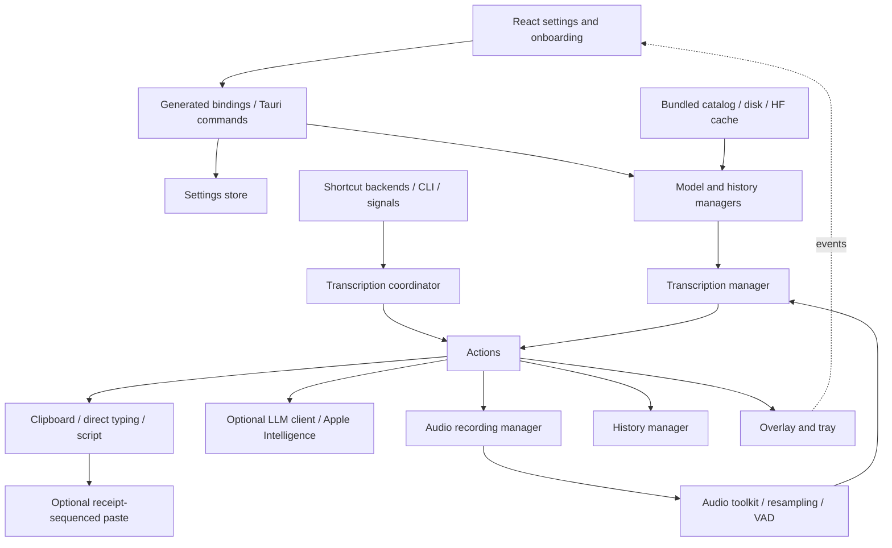
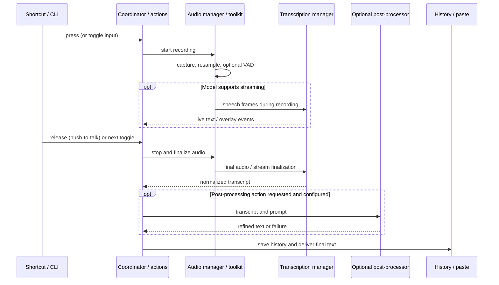

# Architecture

Handy is a Tauri v2 application with a Rust desktop backend and React/TypeScript
webviews. Start with [lib.rs](../src-tauri/src/lib.rs), [App.tsx](../src/App.tsx),
and the [dependency manifest](../src-tauri/Cargo.toml). For operation rather than
implementation, see [settings](settings.md), [models](models.md), and
[platform notes](platform-notes.md).

## Components

### Startup and desktop shell

[lib.rs](../src-tauri/src/lib.rs) registers plugins, commands and typed events,
initializes portable paths before Tauri, and applies single-instance and CLI
behavior. The normal desktop setup creates the main window, loads settings,
installs a `TranscriptionCoordinator`, initializes core managers, starts Secure
Input monitoring, and initializes overlay/tray state. Its headless branch is
separate; not all invocations create a settings window. Frontend onboarding
subsequently calls `initializeEnigo` and `initializeShortcuts`
([App.tsx](../src/App.tsx)).

- [shortcut/](../src-tauri/src/shortcut/mod.rs) selects Tauri or handy-keys input;
  [handler.rs](../src-tauri/src/shortcut/handler.rs) routes transcription inputs
  into the coordinator and dispatches other actions.
- [transcription_coordinator.rs](../src-tauri/src/transcription_coordinator.rs)
  serializes lifecycle inputs and transitions, including push-to-talk/toggle
  behavior, rather than letting simultaneous key events independently start work.
- [actions.rs](../src-tauri/src/actions.rs) implements recording actions and the
  final output pipeline, including optional refinement, history, and paste.
- [signal_handle.rs](../src-tauri/src/signal_handle.rs) and
  [cli.rs](../src-tauri/src/cli.rs) expose alternate controls. CLI remote controls
  reach the running process through the single-instance callback in `lib.rs`.
- [overlay.rs](../src-tauri/src/overlay.rs) handles recording/working display,
  levels, placement and platform window behavior;
  [tray.rs](../src-tauri/src/tray.rs) provides desktop status and menu actions.
- [secure_input.rs](../src-tauri/src/secure_input.rs) monitors macOS Secure Input,
  reports diagnostics, and reconciles supported Carbon fallback shortcuts.
- [portable.rs](../src-tauri/src/portable.rs) centralizes portable-aware data,
  log and store paths. A valid `portable` marker starts with `Handy Portable Mode`;
  data goes into `Data/` next to the executable. Legacy markers are migrated only
  when a `Data/` directory already exists. Shared HF cache models are a separate
  storage path; see [models](models.md).

### Managers and low-level processing

- [AudioRecordingManager](../src-tauri/src/managers/audio.rs): device selection,
  microphone lifecycle, recording buffers, stream routing and stop/finalization.
- [ModelManager](../src-tauri/src/managers/model.rs): registry, downloads,
  discovery, extraction and deletion. [catalog/](../src-tauri/src/catalog/mod.rs)
  supplies bundled descriptors; [model_capabilities.rs](../src-tauri/src/managers/model_capabilities.rs)
  probes compatibility and capabilities.
- [TranscriptionManager](../src-tauri/src/managers/transcription.rs): engine
  loading, accelerator selection, batch/streaming inference, output normalization,
  word correction, filler filtering and idle unloading.
- [HistoryManager](../src-tauri/src/managers/history.rs): transcription history,
  recording files and retention cleanup.
- [audio_toolkit/](../src-tauri/src/audio_toolkit/mod.rs): audio capture and
  resampling, Silero VAD, language identification and text normalization helpers.
- [llm_client.rs](../src-tauri/src/llm_client.rs): HTTP model discovery and chat
  completion protocols; [apple_intelligence.rs](../src-tauri/src/apple_intelligence.rs)
  provides the platform-local alternative.
- [clipboard.rs](../src-tauri/src/clipboard.rs) and
  [input.rs](../src-tauri/src/input.rs): clipboard transactions and input injection.
  [paste_tx/](../src-tauri/src/paste_tx/mod.rs) implements the optional macOS/Windows
  receipt-based restoration path, not speech recognition.

## Recording lifecycle

This is the conceptual path in [actions.rs](../src-tauri/src/actions.rs),
[audio.rs](../src-tauri/src/managers/audio.rs), and
[transcription.rs](../src-tauri/src/managers/transcription.rs). VAD can be disabled.
Streaming is driven by model capability, **not** overlay style. Batch models
produce their transcript after recording; hiding the overlay does not disable
streaming. Empty input and unsuccessful refinement do not manufacture a new
transcript; the refinement path keeps the original on failure. Cancellation and
error paths restore recording/UI state rather than following the happy-path
diagram through to paste.

## Frontend, commands, and events

[App.tsx](../src/App.tsx) owns onboarding and settings navigation.
`src/components/` contains settings, model selector, onboarding, accessibility,
Secure Input warnings, update checker and What's New surfaces. The recording
webview has its own [overlay entry point](../src/overlay).

[settingsStore.ts](../src/stores/settingsStore.ts) is the Zustand settings facade;
[useSettings.ts](../src/hooks/useSettings.ts) exposes it to components.
[modelStore.ts](../src/stores/modelStore.ts) tracks model availability and download
state. [bindings.ts](../src/bindings.ts) is generated by tauri-specta from the Rust
command/event registration in `lib.rs`; change the Rust API rather than treating
generated types as an independent backend contract.

Commands go frontend → generated wrapper → Rust handler → manager or settings
mutation. Handlers live in [commands/](../src-tauri/src/commands/mod.rs) and
`shortcut/mod.rs` (including settings commands). Events travel in the reverse
direction: model download/extraction and `models-updated` events come from
`managers/model.rs`; `show-overlay` / `hide-overlay` from `overlay.rs`;
typed streaming text/phase events from `managers/transcription.rs`; and
`secure-input-changed` from `secure_input.rs`. Consumers must subscribe to the
specific event, not assume every command refreshes every store.

Settings persist as the `settings` object in `settings_store.json` through
tauri-plugin-store, using portable-aware resolution. Rust supplies defaults,
merges missing bindings/providers, migrates old stores and salvages individually
valid fields when parsing fails. The frontend performs optimistic updates and
rolls back failed mutations; it also refreshes on `model-state-changed` events
to pick up backend changes such as recognition language reconciliation.
See [settings.rs](../src-tauri/src/settings.rs) and the
[complete reference](settings.md).
